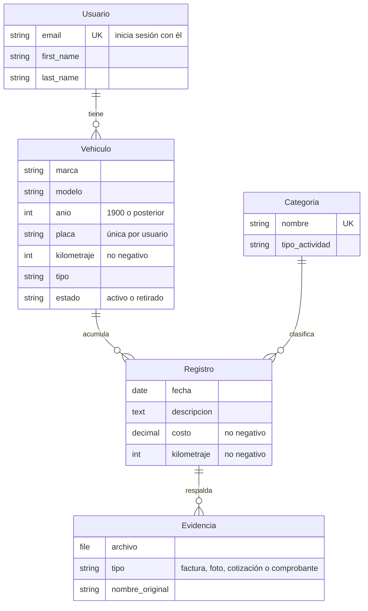

# GestorCar

Este proyecto centraliza el control de un vehículo al reemplazar las notas y
facturas físicas por un registro ordenado y digital.

- Descripción del proyecto: [`docs/Context/Description.md`](docs/Context/Description.md)
- Requisitos: [`docs/Requirements/`](docs/Requirements/)
- Backlog: [`docs/backlogs/Backlogs.md`](docs/backlogs/Backlogs.md)
- Issues y sprints: [`docs/Issues/Issues.md`](docs/Issues/Issues.md), [`docs/sprints/sprints.md`](docs/sprints/sprints.md)

## Requisitos

| Herramienta | Para qué | Versión |
|---|---|---|
| [Docker Desktop](https://www.docker.com/products/docker-desktop/) | Ejecutar la aplicación y PostgreSQL | Docker Compose v2 o superior |
| [Git](https://git-scm.com/) | Control de versiones | — |
| [Node.js](https://nodejs.org/) | OpenSpec, y Tailwind fuera de Docker | 20 o superior |
| Python | Solo si se ejecuta Django fuera de Docker | 3.11 (ver `.python-version`) |

## Puesta en marcha con Docker (recomendado)

```bash
git clone https://github.com/Im-Samuel/GestorCar.git
cd GestorCar
cp .env.example .env        # En PowerShell: Copy-Item .env.example .env
docker compose up
```

La primera vez se descargan las imágenes y se construye la de la aplicación.
Cuando el log muestre `Starting development server`, la aplicación está en
<http://localhost:8000> y el administrador en <http://localhost:8000/admin/>.

`docker compose up` levanta tres servicios:

- `db`: PostgreSQL.
- `web`: espera a la base de datos, aplica las migraciones y arranca Django.
- `tailwind`: compila el CSS y lo vuelve a compilar al guardar una plantilla.

El código está montado en los contenedores: los cambios se recargan sin
reconstruir la imagen.

Comandos habituales (en otra terminal, con los servicios levantados o no):

```bash
docker compose run --rm web python manage.py createsuperuser   # Crear un administrador
docker compose run --rm web python manage.py makemigrations    # Generar migraciones
docker compose down                                            # Detener (los datos se conservan)
docker compose down -v                                         # Detener y BORRAR la base de datos
docker compose build                                           # Reconstruir tras cambiar requirements
```

## Desarrollo local sin Docker para Django

Django se ejecuta en un entorno virtual de tu equipo y PostgreSQL sigue en
Docker. El `DATABASE_URL` de `.env.example` ya apunta a `localhost`.

```powershell
py -3.11 -m venv .venv
.venv\Scripts\Activate.ps1          # En Git Bash: source .venv/Scripts/activate
pip install -r requirements-dev.txt
npm install
docker compose up -d db
python manage.py migrate
python manage.py runserver
```

En otra terminal, deja compilando el CSS mientras trabajas:

```powershell
npm run css:watch
```

## Estructura del proyecto

El código de la aplicación está en una sola app de Django, `gestorcar/`,
organizada por las capas del patrón MVC:

```
GestorCar/
├── config/                 Configuración del proyecto (settings.py, urls.py)
├── gestorcar/              La aplicación
│   ├── models/             M · Un archivo por entidad (usuario.py, vehiculo.py, ...)
│   ├── controllers/        C · Lógica de cada pantalla
│   ├── views/              V · Plantillas HTML
│   ├── forms/              Validación de los formularios
│   ├── urls/               Rutas, una por área (cuentas, vehiculos)
│   ├── admin/              Panel de administración, un archivo por entidad
│   ├── migrations/         Historial de cambios de la base de datos
│   └── tests/              Pruebas, un archivo por entidad o área
├── static/src/app.css      Origen del CSS (Tailwind); se compila a static/css/app.css
├── tests/                  Pruebas del entorno (configuración, base de datos)
├── openspec/               Especificaciones y cambios planificados (OpenSpec)
└── docs/                   Documentación del proyecto
    ├── Context/            Descripción del proyecto
    ├── Requirements/       Requisitos funcionales y no funcionales
    ├── backlogs/           Épicas e historias de usuario
    ├── Issues/             Issues con criterios de aceptación
    └── sprints/            Plan de sprints
```

En la raíz quedan además los archivos de configuración (Docker, Python, npm)
y los que las herramientas exigen ahí: `README.md`, `AGENTS.md` y `CLAUDE.md`.

**Ojo con los nombres de Django.** Lo que el MVC llama *controlador*, Django lo
llama *view*: por eso `gestorcar/controllers/` contiene clases y funciones que
en la documentación de Django aparecen como "views". La carpeta
`gestorcar/views/` contiene las plantillas HTML (lo que Django llama
*templates*).

Para importar un modelo: `from gestorcar.models import Vehiculo`.

## Interfaz: plantillas, estilos y pantallas protegidas

### Plantillas

| Plantilla | Para qué |
|---|---|
| `gestorcar/views/base.html` | Estructura de todas las páginas: barra de navegación, mensajes y bloque `contenido` |
| `gestorcar/views/includes/campo.html` | Un campo de formulario con etiqueta, `*` si es obligatorio, ayuda y errores |
| `gestorcar/views/includes/errores_formulario.html` | Errores que no son de un campo (por ejemplo, credenciales inválidas) |
| `gestorcar/views/includes/menu.html` | Enlaces de la barra de navegación (escritorio y teléfono) |
| `gestorcar/views/<área>/` | Pantallas de cada área: `cuentas/`, `vehiculos/`, ... |

Toda página nueva hereda de `base.html`, y todo campo se dibuja con
`includes/campo.html`:

```django

Mis vehículos

  <form method="post" novalidate class="space-y-4">
    
    
    
    <button type="submit" class="btn btn-primario">Guardar</button>
  </form>

```

`campo.html` muestra cada error junto a su campo y lo enlaza para los lectores
de pantalla: Django agrega `aria-invalid` y `aria-describedby`, y la plantilla
crea los elementos de ayuda y error con esos mismos `id`.

### Estilos con Tailwind

El CSS se escribe con clases de [Tailwind CSS 4](https://tailwindcss.com/docs)
en las plantillas. El origen es `static/src/app.css`, que se compila a
`static/css/app.css` (archivo generado, no se edita ni se sube al repositorio).

| Comando | Para qué |
|---|---|
| `npm run css:watch` | Recompila al guardar (en Docker lo hace el servicio `tailwind`) |
| `npm run css:build` | Compila una vez, minificado |

Clases propias definidas en `static/src/app.css`; úsalas en lugar de repetir
utilidades:

| Clase | Uso |
|---|---|
| `btn` + `btn-primario` / `btn-secundario` / `btn-peligro` | Botones y enlaces con forma de botón (`btn-peligro` para confirmar acciones delicadas) |
| `insignia` + `insignia-activo` / `insignia-retirado` | Etiquetas de estado |
| `tarjeta` | Contenedor blanco con borde y sombra |
| `enlace` | Enlaces de texto |
| `campo`, `campo-ayuda`, `campo-error` | Partes de un campo (ya las usa `campo.html`) |

**Escribe siempre el nombre completo de cada clase.** Tailwind busca los
nombres literales en `gestorcar/`; algo como `"bg-" + color` o
`bg-{{ color }}` no se detecta y la clase no existirá en el CSS. Usa
`` con las dos clases completas.

### Pantallas protegidas y datos de cada usuario

Todas las páginas exigen sesión iniciada sin que tengas que hacer nada
(`LoginRequiredMiddleware`). Solo las de registro e inicio de sesión son
públicas; para que otra lo sea, decórala con `@login_not_required`.

Para que un usuario solo vea sus propios datos, las vistas genéricas usan
`PropietarioMixin` (`gestorcar/controllers/mixins.py`). Si alguien pide un dato
de otro usuario, recibe "no encontrado" (404):

```python
from django.views.generic import DetailView

from gestorcar.controllers.mixins import PropietarioMixin
from gestorcar.models import Registro


class DetalleRegistroView(PropietarioMixin, DetailView):
    model = Registro
    campo_propietario = "vehiculo__usuario"  # Ruta desde Registro hasta su dueño.
    template_name = "registros/detalle.html"
```

Pasos para una pantalla nueva: controlador en `gestorcar/controllers/<área>.py`,
formulario en `gestorcar/forms/<área>.py`, ruta en `gestorcar/urls/<área>.py`
y plantilla en `gestorcar/views/<área>/`.

## Modelo de datos



| Archivo en `gestorcar/models/` | Modelo |
|---|---|
| `usuario.py` | `Usuario` (modelo de autenticación del proyecto: `AUTH_USER_MODEL`) |
| `vehiculo.py` | `Vehiculo` |
| `categoria.py` | `Categoria` |
| `registro.py` | `Registro` (gasto o intervención) |
| `evidencia.py` | `Evidencia` |

La base de datos protege el historial: no se puede borrar un usuario con
vehículos, un vehículo con registros ni una categoría en uso. Al borrar un
registro se borran sus evidencias. Cada petición web es una transacción
completa (`ATOMIC_REQUESTS`).

**Cambios en los modelos.** Toda la aplicación comparte un único historial de
migraciones, así que antes de modificar un modelo avisa al equipo: si dos ramas
crean una migración a la vez, ambas tendrán el mismo número y Django se negará
a aplicarlas. En ese caso, quien fusiona después ejecuta
`python manage.py makemigrations --merge` (o borra su migración y la vuelve a
generar sobre `main`). Cada cambio de modelo va con su migración en el mismo
pull request, y `pytest` comprueba que no queden modelos sin migrar.

## Variables de entorno

Todas están documentadas en [`.env.example`](.env.example). El archivo `.env`
es personal y no se sube al repositorio. `SECRET_KEY` y `DATABASE_URL` son
obligatorias: si faltan, Django no arranca e indica cuál falta. Si `DEBUG` no
se define, vale `False`.

## Calidad: linter, formato y pruebas

| Tarea | Con Docker | En el entorno local |
|---|---|---|
| Revisar el código | `docker compose run --rm web ruff check .` | `ruff check .` |
| Formatear el código | `docker compose run --rm web ruff format .` | `ruff format .` |
| Ejecutar las pruebas | `docker compose run --rm web pytest` | `pytest` |

Las pruebas viven en `tests/` y en el `tests.py` o `test_*.py` de cada app.
La configuración de `ruff` y `pytest` está en `pyproject.toml`.

## Trabajo con OpenSpec

Los cambios se planifican con [OpenSpec](https://github.com/Fission-AI/OpenSpec)
antes de implementarse. La CLI se instala con las dependencias de npm del
proyecto:

```bash
npm install
npx openspec list          # Cambios en curso
npx openspec list --specs  # Especificaciones vigentes
```

| Paso | Claude Code | OpenCode |
|---|---|---|
| Proponer un cambio (proposal, specs, design, tasks) | `/opsx:propose <descripción>` | `/opsx-propose <descripción>` |
| Explorar una idea antes de proponer | `/opsx:explore` | `/opsx-explore` |
| Ajustar una propuesta | `/opsx:update <cambio>` | `/opsx-update <cambio>` |
| Implementar las tareas | `/opsx:apply <cambio>` | `/opsx-apply <cambio>` |
| Verificar la implementación | `/opsx:verify <cambio>` | `/opsx-verify <cambio>` |
| Archivar tras fusionar | `/opsx:archive <cambio>` | `/opsx-archive <cambio>` |

Flujo: proponer → revisar la propuesta en equipo → implementar → verificar →
fusionar → archivar.

Se versionan en el repositorio:

- `openspec/`: especificaciones vigentes (`specs/`), cambios en curso y
  archivados (`changes/`) y la configuración (`config.yaml`).
- `.claude/` y `.opencode/`: comandos y skills de OpenSpec para cada
  herramienta. `.claude/settings.local.json` es personal y está ignorado.
- `AGENTS.md` y `CLAUDE.md`: instrucciones comunes para los agentes de IA.

## Convenciones del equipo

**Ramas.** Nunca se trabaja directamente sobre `main`. Cada issue tiene su
rama, con el número del issue:

```
feature/ISSUE-001-modelos-datos
fix/ISSUE-005-validacion-costo
docs/ISSUE-000-readme
```

**Commits.** Un commit por cambio lógico, en español y en imperativo, con el
formato `tipo(ISSUE-XXX): descripción`. Tipos: `feat`, `fix`, `docs`, `test`,
`refactor`, `chore`.

```
feat(ISSUE-001): agrega el modelo de vehículo con placa única por usuario
test(ISSUE-001): cubre la protección del historial al borrar vehículos
```

**Pull requests.**

- Van de la rama del issue hacia `main`.
- La descripción indica el ISSUE, los RF/RNF que cubre y el cambio de OpenSpec
  correspondiente.
- Antes de pedir revisión, `ruff check .`, `ruff format --check .` y `pytest`
  deben pasar.
- Se fusionan con la aprobación de al menos un integrante distinto del autor.

## Problemas conocidos

- **El puerto 5432 ya está en uso** (PostgreSQL instalado en el equipo): cambia
  `DB_PORT` en `.env`, por ejemplo a `5433`, y el puerto de `DATABASE_URL`.
- **Docker Desktop no descarga imágenes** con errores como `no such host`: suele
  ser un fallo temporal de DNS; vuelve a ejecutar el comando.
- **Docker va lento en Windows**: clonar el repositorio dentro de WSL2 mejora
  mucho la velocidad de los volúmenes montados.
- **Las páginas se ven sin estilos**: el CSS no está compilado. Revisa que el
  servicio `tailwind` esté corriendo (`docker compose logs tailwind`) o ejecuta
  `npm run css:build`.
- **Las migraciones fallan tras cambiar el modelo de usuario**: borra la base de
  datos de desarrollo con `docker compose down -v` y vuelve a levantarla.
